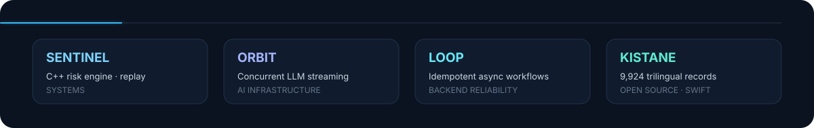

  

  
  
  

I build **reliable product systems** across backend, AI, web, and mobile. Computer Science student at **San Diego State University**, interested in distributed systems, developer infrastructure, and software that serves real communities.

| Project | Engineering focus | Proof |
|:--|:--|:--|
| **[Sentinel](https://github.com/tenth-package0/sentinel)** | C++/Python risk engine, streaming events, deterministic replay | Live system demo + tested core |
| **[Orbit](https://github.com/tenth-package0/orbit)** · **[Live](https://orbitmodels.dev)** | Concurrent LLM streaming with typed SSE events | GPT, Claude, and Gemini in one workspace |
| **Loop** · **[Live](https://loopapplication.com)** | Idempotent Shopify workflows and async workers | 3,300+ automated tests |
| **[Kistane](https://github.com/tenth-package0/kistane-ios)** | SwiftUI language-preservation app and typo-tolerant search | 9,924 trilingual records |

### Currently

- Contributing a correctness fix and regression coverage to **[Google DeepMind OpenSpiel](https://github.com/google-deepmind/open_spiel/pull/1640)**.
- Building secure, observable systems where failure modes are explicit and testable.
- Open to **2027 software engineering internships**.

  
    
  <b>Build for the user · Design for failure · Measure what matters · Keep shipping</b>

